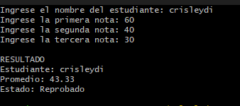

# Manual de Usuario

## 1. Propósito
Este manual explica cómo utilizar la Calculadora de Promedio para obtener el promedio de tres notas y saber si el estudiante está aprobado o reprobado.

## 2. Inicio
1. Abrir la carpeta del proyecto.
2. Ejecutar el archivo calculadora_promedio.py.
3. Esperar que aparezca el mensaje CALCULADORA DE PROMEDIO.

## 3. Calcular un promedio
1. Escribir el nombre del estudiante y presionar Enter.
2. Escribir la primera nota y presionar Enter.
3. Escribir la segunda nota y presionar Enter.
4. Escribir la tercera nota y presionar Enter.
5. Revisar el resultado mostrado al finalizar.

## 4. Resultado esperado
El sistema mostrará el nombre del estudiante, su promedio y el estado: Aprobado si el promedio es 51 o más, y Reprobado si es menor.

## 5. Problemas comunes
- Si el programa muestra un error al ingresar una nota, verificar que se escribieron solo números (por ejemplo 70 o 65.5) y no letras. Luego volver a ejecutar el programa.
- Si el programa no inicia, verificar que Python esté instalado.

## 6. Evidencia del sistema

